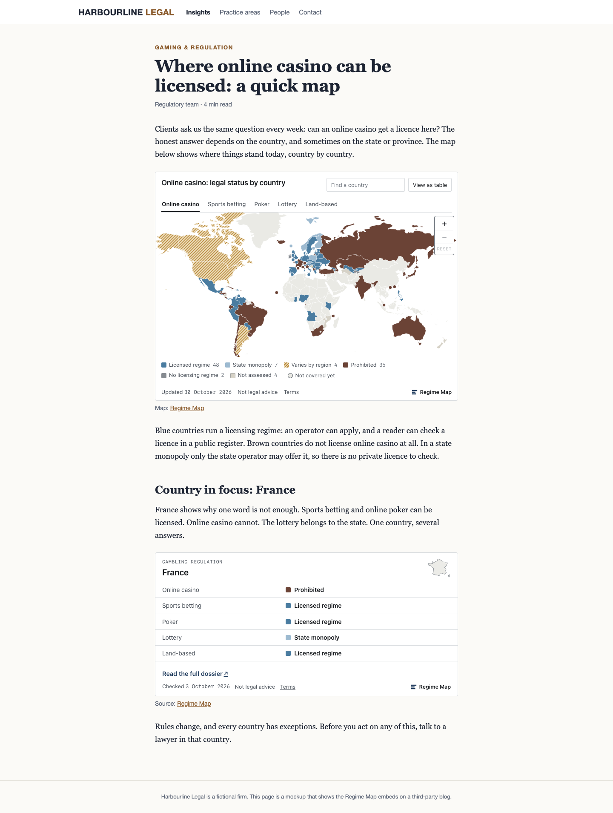
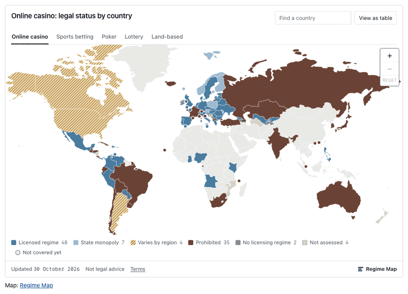

# Regime Map embeds: examples

Copy-paste examples for the free [Regime Map](https://regimemap.com/data-api/) embeds:
a **world map of gambling regulation** for five products, and a **country card** with one
country's status for each of them.



- **100 countries and Northern Ireland, 5 products:** online casino, sports betting,
  poker, lottery, land-based.
  - On the map, readers switch between products; you choose which shows first.
  - Lawful exceptions are marked.
- **39 languages,** and the code you paste comes in that language too:
  - en es no pt ja ko ru de fr it nl pl uk tr sv da fi cs sk hu ro el bg hr sr-Latn sl
    mk sq lt lv et is ca kk uz az ka hy zh-Hant;
  - each with its own country names, dates and alphabetical order.
- **The map:** zoom (+ / − / Reset), "Find a country", five views (world, Europe,
  Americas, Africa, Asia and Pacific), a table view.
- **The card:** five products, any exception, the US and Canada linked to their state
  or province view.
- **Themes:** light, dark, or follow the reader's setting.
- **Two forms:** the script form (Shadow DOM: your CSS can't break it, and it can't touch
  your page) or the iframe form for sites that strip scripts.
- **Small:** about 46 KB gzipped for the map (loader, renderer with the map geometry,
  data) and about 8 KB for a card. Nothing loads until the embed nears the viewport.
- **Private:** no cookies (script or iframe), nothing stored in the reader's browser,
  nothing loaded from any other website. Regime Map doesn't log or keep readers' IP
  addresses.
- **Accessible:** a table view of the map, full keyboard support, 44 px touch targets,
  reduced motion respected.



## Quick start

The code below is exactly what <https://regimemap.com/data-api/> gives. Take yours from
there too (it writes it for any product, region, country, language, theme and form,
including the iframe form with the card's exact height), and don't edit it by hand.

```html
<div data-regimemap="map" data-lang="en" data-region="world" data-theme="light">Interactive map: gambling regulation by country.</div>
<p>Map: <a href="https://regimemap.com/gambling-regulation-map/">Regime Map</a></p>
<script async src="https://regimemap.com/embed/v1/embed.js" referrerpolicy="no-referrer"></script>
```

A country card:

```html
<div data-regimemap="country" data-country="FR" data-lang="en" data-theme="light">France: gambling regulation by product.</div>
<p>Source: <a href="https://regimemap.com/gambling-regulation-map/france/">Regime Map</a></p>
<script async src="https://regimemap.com/embed/v1/embed.js" referrerpolicy="no-referrer"></script>
```

The map with sports betting shown first, in German:

```html
<div data-regimemap="map" data-product="sports_betting" data-lang="de" data-region="world" data-theme="light">Interaktive Karte: Glücksspielregulierung nach Ländern.</div>
<p>Karte: <a href="https://regimemap.com/gambling-regulation-map/">Regime Map</a></p>
<script async src="https://regimemap.com/embed/v1/embed.js" referrerpolicy="no-referrer"></script>
```

## Options

| attribute | values | default |
|---|---|---|
| `data-regimemap` | `map`, `country` | (required) |
| `data-country` | ISO 3166-1 alpha-2, e.g. `FR`, `JP`, `US` (card only) | (required for a card) |
| `data-product` | `online_casino`, `sports_betting`, `poker`, `lottery`, `land_based` (map only: shown first) | `online_casino` |
| `data-lang` | any of the 39 codes above | the page's `lang` if it is one of them, else `en` |
| `data-region` | `world`, `europe`, `americas`, `africa`, `asia` (map only) | `world` |
| `data-theme` | `light`, `dark`, `auto` | `light` |

The iframe URLs take the same values as query parameters (`lang`, `region`, `theme`,
`product`).

## Examples in this repo

- `index.html`: the interactive demo (served on GitHub Pages).
- `basic-script.html`: the map and a card, script form.
- `basic-iframe.html`: the same as iframes.
- `gallery.html`:
  - the five products;
  - every region and the dark theme;
  - the map in four more languages;
  - a card in fourteen.
- `react/RegimeMap.jsx`: React / Next.js components. Single-page apps call
  `window.RegimeMapEmbed.scan()` after adding an embed.

Live demos with a configurator (pick the map or a country, a language, a theme and a form, and copy the code):

- GitHub Pages: <https://regimemap.github.io/regimemap-embed-examples/> (`index.html` in this repo)
- Hugging Face: <https://huggingface.co/spaces/regimemap/embeds>

## Content-Security-Policy

- **Script form:** allow `https://regimemap.com` in `script-src` and `connect-src`, and in
  `style-src` if your policy blocks constructed stylesheets.
- **Iframe form:** allow it in `frame-src`.

## Terms (short)

- **Free to embed** on any site, commercial or not.
- **Keep the credit line and its link visible.**
  - It may be in English or in the embed's language; the link text is always
    "Regime Map".
  - You may add `rel="nofollow"`.
- **Display only:** don't copy, store or resell the data behind the embeds.
- **Not legal advice.**
- **Full terms**, binding in English: <https://regimemap.com/data-api/#embed-terms>.

## License

The example code in this repository: MIT. The data and the embeds remain Regime Map's,
displayed under the embed terms above.
